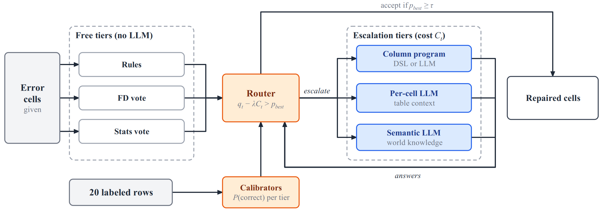
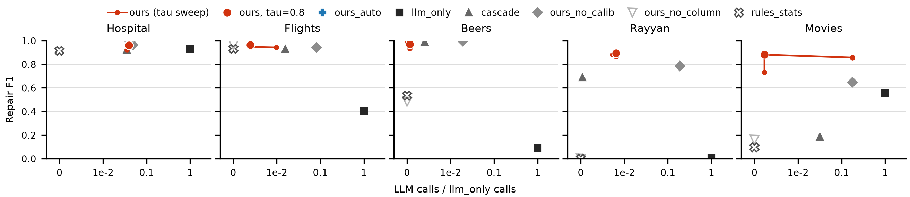

# ThriftClean: Confidence-Calibrated Routing for Hybrid Tabular Data Cleaning

> **Official code, tables, and figures for the KDBC 2026 poster.**  
> *Published in Proc. 28th Korean DataBase Conference (KDBC 2026), Seoul, Korea, Nov. 2026, p. 139.*

---

## The Story: Why We Built ThriftClean

Cleaning dirty tabular data usually forces an uncomfortable trade-off:

- **Traditional rule & statistical cleaners** are fast and free, but they struggle when an error requires a custom string transformation or outside world knowledge.
- **LLM-only cleaners** can handle subtle semantics, but calling an LLM on every erroneous cell is slow, costly, and surprisingly brittle on structured relational tables—for example, prompting `Qwen3-8B` on every dirty cell reaches only **0.402 F1** on *Flights*, **0.090 F1** on *Beers*, and **0.002 F1** on *Rayyan*, while burning thousands of LLM calls.

**ThriftClean** asks a simple question: *What if a cleaner tried cheap, deterministic repairs first, knew how trustworthy each method actually was, and only escalated to an LLM when the expected accuracy gain justified the cost?*

Using just **20 labeled rows** per dataset and a local `Qwen3-8B` model served via `vLLM`, ThriftClean routes every erroneous cell through a calibrated, cost-ordered cascade—cutting LLM calls by **~90%+** compared to LLM-only repair while achieving **0.884–0.987 F1** across five benchmark datasets.

---

## How ThriftClean Works

Given known error locations (oracle detection), ThriftClean processes each dirty cell in four stages:

1. **Try Free Tiers First (0 LLM Calls)**  
   Every cell is first evaluated by three zero-cost tiers:
   - **Rules:** Format and null-handling rules.
   - **FD Vote:** Voting under functional dependencies (proposed once per dataset and validated on the labeled rows).
   - **Stats Vote:** Statistical dependency voting across table columns.

2. **Calibrate Every Tier's Confidence**  
   Raw confidence scores from different repair methods are not directly comparable. Using the **20 labeled rows**, ThriftClean fits a per-tier calibrator (isotonic regression, Platt scaling, or a Laplace constant when labeled evidence is scarce; column programs carry their own leave-one-out score) to map each candidate's score to an actual probability of correctness, $P(\text{correct})$. The best free candidate establishes the baseline confidence $p_{\text{best}}$.

3. **Escalate Only When It Pays Off**  
   The router walks paid escalation tiers in increasing cost order and buys tier $t$ **only if** its estimated accuracy $q_t$ minus a budget penalty $\lambda \cdot C_t$ beats the current best candidate:
   $$q_t - \lambda C_t > p_{\text{best}}$$
   - **Column Program:** Synthesizes a reusable transformation for a systematic error group—either a free DSL program ($C_t = 0$) or a verified LLM-written program whose cost is amortized over the group ($C_t = \text{calls} / \text{group size}$).
   - **Per-Cell LLM:** Prompts the LLM with surrounding table context for difficult individual cells.
   - **Semantic LLM:** Uses a world-knowledge prompt for cells that no relational or structural tier can resolve (after per-cell LLM, or directly when labeled evidence supports the semantic tier).

4. **Accept Confidently — or Abstain Safely**  
   After routing finishes, ThriftClean accepts the best candidate if $p_{\text{best}} \ge \tau$ (with $\tau$ cross-fitted on the 20 labeled rows). Otherwise, it **abstains** and keeps the original cell value instead of introducing a wrong repair. Setting $\lambda = 0$ maximizes quality; increasing $\lambda$ smoothly trades quality for fewer LLM calls.

---

## Architecture



* **Grey (Free tiers):** Deterministic rules, functional-dependency voting, and statistical voting run without any LLM calls.
* **Orange (Calibration & Routing):** Per-tier calibrators fitted on 20 labeled rows feed calibrated probabilities into the budget-aware router ($q_t - \lambda C_t > p_{\text{best}}$).
* **Blue (Escalation tiers):** Column programs, per-cell table-context LLM, and semantic world-knowledge LLM are invoked only when expected to outperform cheaper tiers.

*(Vector and print versions available at `paper/figures/thriftclean_arch.{png,pdf,svg}`.)*

---

## Results & Key Takeaways

Evaluation uses **perfect error detection**, **20 labeled rows**, and **mean F1 across 3 seeds**. Total LLM calls are shown in brackets `[calls]`.

| Method | Hospital | Flights | Beers | Rayyan | Movies *(held-out)* |
|---|---|---|---|---|---|
| **ThriftClean ($\lambda=0$, Qwen3-8B)** | **0.960** `[22]` | 0.946 `[128]` | **0.987** `[16]` | **0.894** `[55]` | **0.884** `[1572]` |
| LLM-only (Qwen3-8B, every error cell) | 0.925 `[485]` | 0.402 `[4870]` | 0.090 `[4327]` | 0.002 `[923]` | 0.556 `[7648]` |
| Baran (reproduced, same rows, no LLM) | 0.752 | **0.969** | 0.906 | 0.342 | 0.830 |

**Highlights:**
- **Dramatically fewer LLM calls:** Cuts LLM usage from thousands of calls down to tens on structured tables (e.g., `485 → 22` on *Hospital*, `4327 → 16` on *Beers*, `923 → 55` on *Rayyan*).
- **Stronger accuracy than both extremes:** Beats LLM-only on all 5 datasets and outperforms the reproduced Baran baseline on 4 of 5 datasets (including held-out *Movies*).
- **Safe abstention:** Cross-fitted confidence thresholding keeps the original value whenever no candidate is trustworthy.

### Accuracy vs. LLM Cost Frontier



> Full paper tables (`T1`–`T9`) are in [`paper/tables/final_tables.md`](paper/tables/final_tables.md) (plus `tables.tex` and individual `T*.csv` files; see [`paper/tables/README.md`](paper/tables/README.md)). Additional figures are in [`paper/figures/`](paper/figures/), and published/LLM-only baseline summaries live in [`results/summary/`](results/summary/).

---

## Repository Structure

```text
ThriftClean/
├── src/
│   ├── pipeline.py               # Core repair tiers, calibration, and budget-aware router
│   ├── run.py                    # CLI for precompute, eval, semantic injection, and sweeps
│   ├── baran_baseline.py         # Reproduced Baran baseline runner
│   ├── llm_only_baselines.py     # LLM-only baseline evaluation
│   ├── sem_direct_comparison.py  # Semantic-tier routing comparisons
│   └── make_tables.py            # Paper table generator
├── scripts/
│   ├── serve_vllm.sh             # Launch local Qwen3-8B server via vLLM
│   └── reproduce.sh              # End-to-end reproduction sequence
├── paper/
│   ├── figures/                  # Architecture & result figures (PNG, PDF, SVG)
│   └── tables/                   # Final tables T1–T9 (Markdown, LaTeX, CSV)
├── results/summary/              # Published & LLM-only baseline summaries
├── tests/test_pipeline.py        # 55 unit tests (no LLM or datasets required)
└── requirements.txt
```

---

## Quickstart & Reproduction

### 1. Install & Run Unit Tests
No GPU, LLM server, or datasets are needed to verify the core pipeline:

```bash
python3 -m venv .venv
source .venv/bin/activate
pip install -r requirements.txt
python tests/test_pipeline.py   # 55 unit tests
```

### 2. Serve the Local LLM (Optional — Requires GPU)
Use a separate virtual environment for `vLLM`:

```bash
python3 -m venv .venv-vllm
.venv-vllm/bin/pip install vllm
scripts/serve_vllm.sh           # Serves Qwen/Qwen3-8B on :8000 (override with MODEL=<name>)
export LLM_BASE_URL=http://localhost:8000/v1
export LLM_MODEL=Qwen/Qwen3-8B
```

> **Note:** `scripts/serve_vllm.sh` sets `CUDA_HOME`, `PATH`, and `VLLM_USE_FLASHINFER_SAMPLER=0` for machines without a system CUDA toolkit—edit or remove those lines to match your environment.  
> **Useful environment variables:** `CACHE_DIR`, `RESULTS_DIR`, and `LLM_STUB=1` (disables LLM calls while still running all non-LLM tiers).

### 3. Prepare Datasets
Raw benchmark datasets are not bundled in this repository. Place each dataset under `data/<name>/dirty.csv` and `data/<name>/clean.csv` for `hospital`, `flights`, `beers`, `rayyan`, and `movies`.

To generate the semantic-injected variants:
```bash
python src/run.py inject-semantic --dataset hospital
python src/run.py inject-semantic --dataset beers
```

### 4. Precompute & Evaluate
```bash
python src/run.py precompute --dataset hospital   # Calls LLM and writes cache/
python src/run.py eval --dataset hospital         # Replay-only evaluation (no LLM), writes results/
scripts/reproduce.sh                              # Full ordered reproduction pipeline
```

> Precompute steps invoke the LLM and LLM caches are not included in git. Everything from `eval` onward is replay-only. Note that `src/make_tables.py` requires the regenerated sweep/cache outputs from `scripts/reproduce.sh` to rebuild all tables from scratch.

<details>
<summary><strong>Optional: Reproduce the Baran Baseline (separate environment)</strong></summary>

`raha` requires older versions of `pandas` and `scikit-learn`, so install it in its own virtual environment:

```bash
python3 -m venv .venv-raha
.venv-raha/bin/pip install raha "numpy==1.26.4" "pandas==2.1.4" "scikit-learn==1.3.2" "scipy<1.13" matplotlib==3.8.4
.venv-raha/bin/python src/baran_baseline.py --datasets hospital flights beers rayyan
```

</details>

---

## Citation

If you use ThriftClean in your research, please cite our KDBC 2026 paper:

```bibtex
@inproceedings{rodro2026thriftclean,
  author    = {Rodro, Hasibul Haque and Lei, Han and Oh, Sunghan and Kim, Dohee},
  title     = {ThriftClean: Confidence-Calibrated Routing for Hybrid Tabular Data Cleaning},
  booktitle = {Proceedings of the 28th Korean DataBase Conference (KDBC 2026)},
  address   = {Seoul, Korea},
  month     = nov,
  year      = {2026},
  pages     = {139}
}
```
